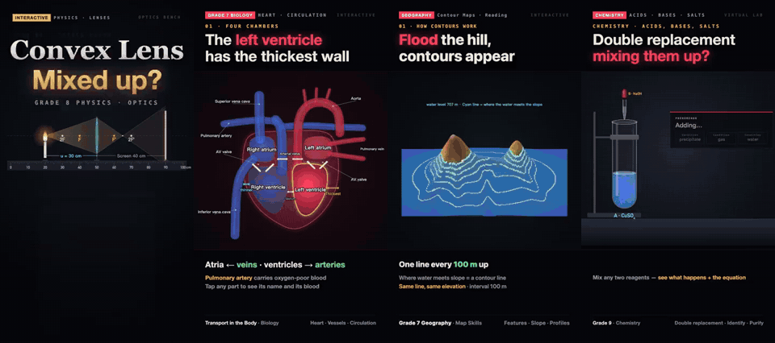
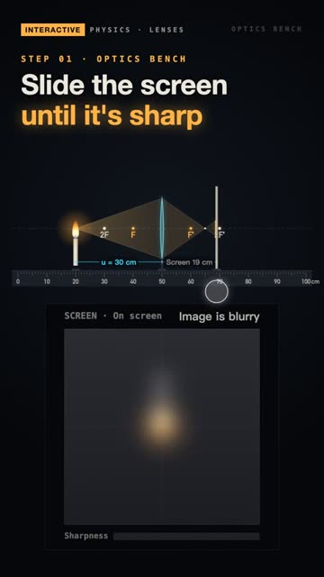
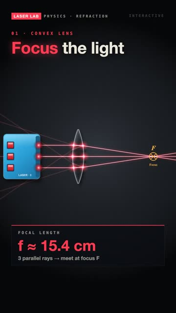
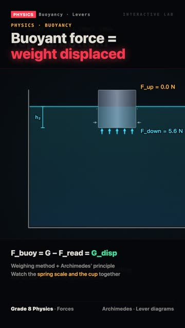
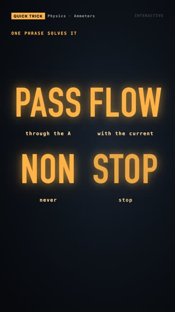
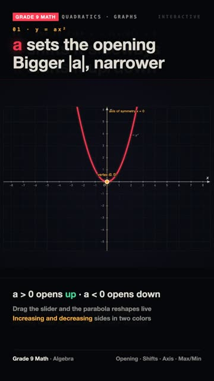
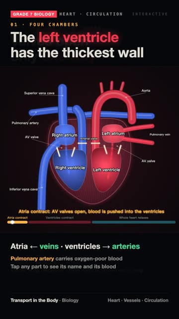
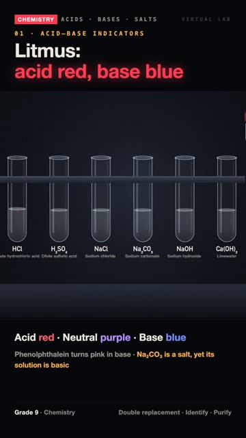
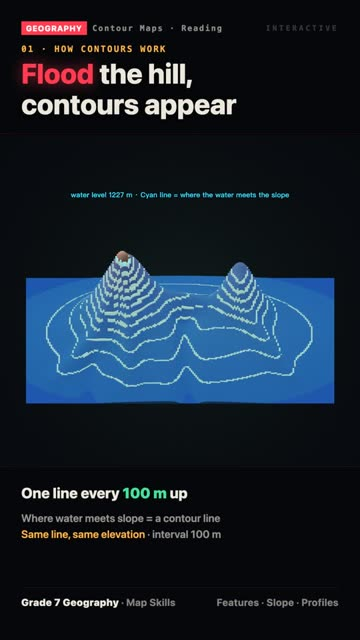

# Interactive Science Labs

**Free, single-file HTML science and math simulations for middle school classrooms.**
No install, no sign-up, no internet needed. Open the file in any browser, put it on the projector, and let students drag, tweak and see.

<table>
<tr><td align="center" valign="top" width="25%"> <b><a href="https://www.youxiaojia.cn/huoye/library/convex-lens-en.html">Convex Lens Lab</a></b> Physics · Grade 8</td><td align="center" valign="top" width="25%"> <b><a href="https://www.youxiaojia.cn/huoye/library/laser-optics-lab-en.html">Laser Optics Lab</a></b> Physics · Grade 8</td><td align="center" valign="top" width="25%"> <b><a href="https://www.youxiaojia.cn/huoye/library/buoyancy-lever-en.html">Buoyancy & Levers</a></b> Physics · Grade 8</td><td align="center" valign="top" width="25%"> <b><a href="https://www.youxiaojia.cn/huoye/library/ammeter-circuits-en.html">What Does the Ammeter Read?</a></b> Physics · Grade 9</td></tr>
<tr><td align="center" valign="top" width="25%"> <b><a href="https://www.youxiaojia.cn/huoye/library/quadratic-functions-en.html">Quadratic Graphs</a></b> Math · Grade 9</td><td align="center" valign="top" width="25%"> <b><a href="https://www.youxiaojia.cn/huoye/library/blood-circulation-en.html">Heart & Circulation</a></b> Biology · Grade 7</td><td align="center" valign="top" width="25%"> <b><a href="https://www.youxiaojia.cn/huoye/library/acids-bases-salts-en.html">Acids & Bases Lab</a></b> Chemistry · Grade 9</td><td align="center" valign="top" width="25%"> <b><a href="https://www.youxiaojia.cn/huoye/library/contour-maps-en.html">Contour Maps</a></b> Geography · Grade 7</td></tr>
</table>

## The labs

| Lab | Subject | Grade | What students do | File |
|---|---|---|---|---|
| [Convex Lens Lab](https://www.youxiaojia.cn/huoye/library/convex-lens-en.html) | Physics | 8 | Drag the candle and watch real ray tracing form each image: real vs virtual, bigger vs smaller. | [`labs/convex-lens.html`](labs/convex-lens.html) |
| [Laser Optics Lab](https://www.youxiaojia.cn/huoye/library/laser-optics-lab-en.html) | Physics | 8 | Send a laser through convex and concave lenses, mirrors and glass; watch it bend live. | [`labs/laser-optics-lab.html`](labs/laser-optics-lab.html) |
| [Buoyancy & Levers](https://www.youxiaojia.cn/huoye/library/buoyancy-lever-en.html) | Physics | 8 | Weigh objects in water, see Archimedes' principle, then balance a lever. | [`labs/buoyancy-lever.html`](labs/buoyancy-lever.html) |
| [What Does the Ammeter Read?](https://www.youxiaojia.cn/huoye/library/ammeter-circuits-en.html) | Physics | 9 | Visible current flow shows which branch an ammeter actually measures. | [`labs/ammeter-circuits.html`](labs/ammeter-circuits.html) |
| [Quadratic Graphs](https://www.youxiaojia.cn/huoye/library/quadratic-functions-en.html) | Math | 9 | Drag a, h and k and watch the parabola reshape: opening, vertex, axis, extremes. | [`labs/quadratic-functions.html`](labs/quadratic-functions.html) |
| [Heart & Circulation](https://www.youxiaojia.cn/huoye/library/blood-circulation-en.html) | Biology | 7 | Follow one drop of blood through the four chambers and both circulations. | [`labs/blood-circulation.html`](labs/blood-circulation.html) |
| [Acids & Bases Lab](https://www.youxiaojia.cn/huoye/library/acids-bases-salts-en.html) | Chemistry | 9 | Indicators, neutralization and double-replacement reactions in a virtual lab. | [`labs/acids-bases-salts.html`](labs/acids-bases-salts.html) |
| [Contour Maps](https://www.youxiaojia.cn/huoye/library/contour-maps-en.html) | Geography | 7 | Flood a 3D hill and watch contour lines appear; peaks, valleys, saddles, cliffs. | [`labs/contour-maps.html`](labs/contour-maps.html) |

Every lab is a guided sequence of short scenes. Each scene has one idea and one thing to drag, and most labs end with a quick challenge. Teacher notes are built in.

## Use it in class

- **Play online:** click any lab above. It works on phones, tablets, laptops and interactive whiteboards.
- **Offline:** download a file from [`labs/`](labs) and double-click it. Everything (code, graphics, sound) is inside that one HTML file.
- **Embed:** drop it into an `<iframe>` in your LMS, Google Sites or class blog.
- **Fullscreen:** use the Fullscreen button in the top right for projectors.

## Make your own

These labs are a sample of what [**LivePage**](https://apps.apple.com/app/id6837615778) makes. Snap a photo of any textbook page and LivePage turns it into an interactive lesson like these in about 3 minutes, in English, 简体中文, 繁體中文, 日本語 or 한국어.

## Contributing

Found a physics mistake, a typo or a bug on your device? [Open an issue](../../issues). Requests for new topics are welcome too.

## License

[CC BY-NC 4.0](LICENSE). Free to use, share and adapt for teaching and other non-commercial purposes, with credit to LivePage and a link back to this repository.
